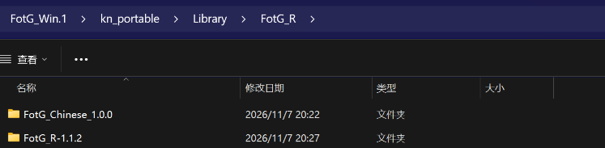
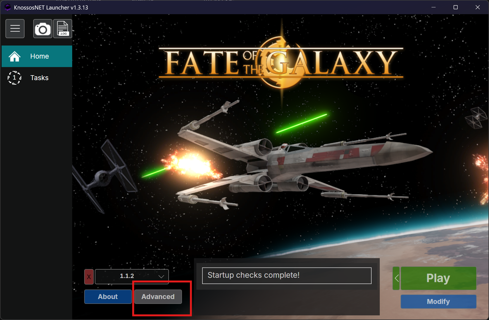
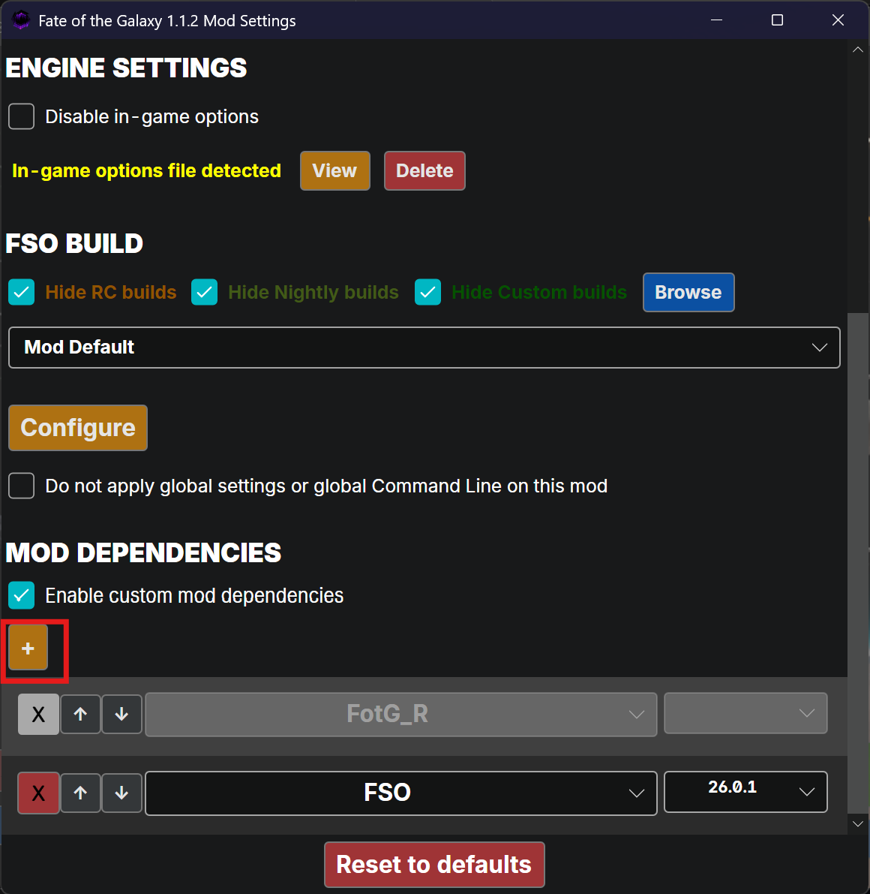
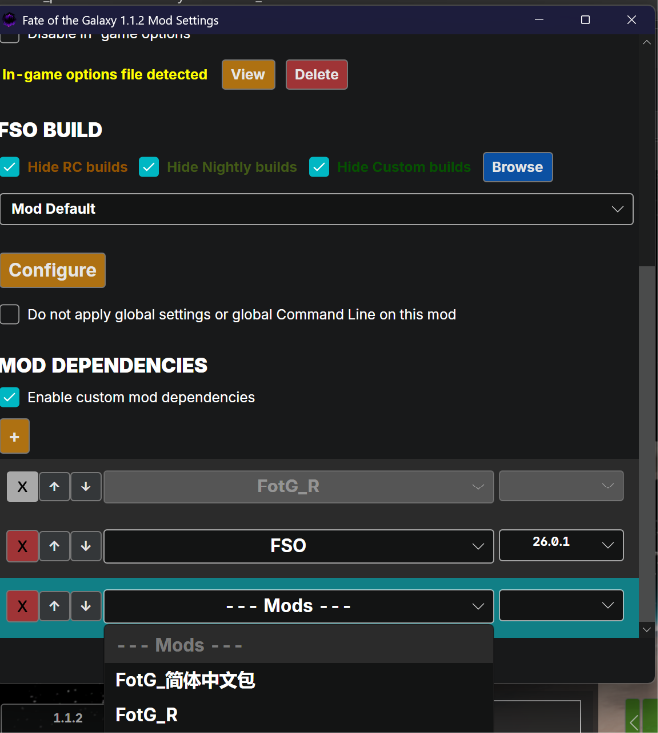
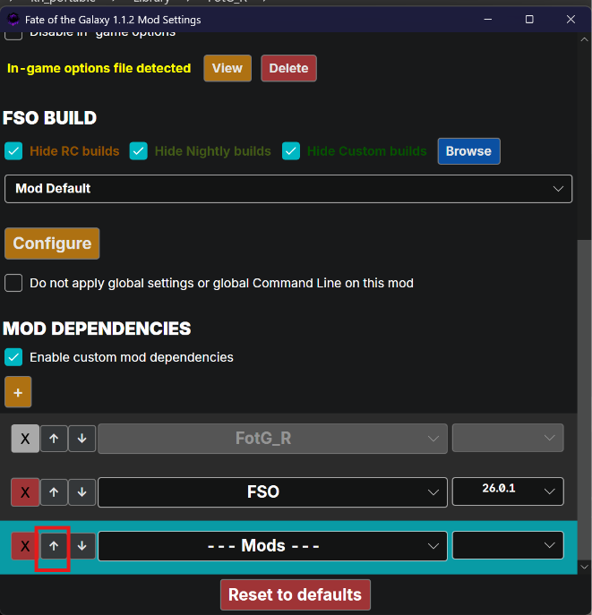

# FotG简体中文包

《命运银河》（Fate of the Galaxy, FotG）的简体中文汉化包，适用于 FreeSpace Open。

## 内容

- `contents/data/tables/`
  - `tstrings.tbl`：任务简报、战役剧情、事件叙述、科技描述等全部中文文本
  - `strings.tbl` / `str_fotg_1-lcl.tbm`：引擎界面、选项、提示等
  - `zz_fotg_zh-tlc.tbm` / `zz_fotg_zh-lcl.tbm`：模块化覆盖表，避免加载顺序影响
  - `zz_fotg_zh-shp.tbm` / `zz_fotg_zh-wep.tbm`：舰船、武器显示名（按星战中文术语表）
  - `help.tbl`、`mainhall.tbl`、`rank.tbl`、`tips.tbl`、`medals.tbl`
  - `lua/0_GCW-sct.lua`：GCW 动态战役脚本中文版
- `contents/data/missions/`
  - GCW 战役名中文覆盖文件
  - Assault 模式单人任务副本（移除 Red Alert 标记以便在任务列表显示）

## 安装方法

### Windows 版

1. 解压后，将 `FotG_Chinese_1.0.0` 文件夹放到 `\FotG_Win.1\kn_portable\Library\FotG_R` 中。

   

2. 运行 `Knossos.NET.exe`，然后点击 **Advanced**。

   

3. 下滑到最下方，点击 **+ 号** 添加 mod。

   

4. 选择 **FotG_简体中文包**。

   

5. 点击 **↑**，将 mod 依赖程度提到最高。

   

6. 最后启动游戏即可生效。

## 术语

舰船、武器、人物、地点等专有名词参照星战中文术语表（namelist）统一翻译。

## 说明

- 内部 `$Name` 保持英文，仅覆盖显示名，避免任务/脚本引用失效。
- 文本已适配 FSO 26.2.0 的 token 长度限制（技术标题 31 字节、帮助文本 128 字节）。
- 字体文件已包含在本包内。

## 新增关卡兼容性检查

自行加入新的 `.fs2` 任务后，可运行：

```
python tools/check_mission_xstr.py <missions目录> <tstrings.tbl>
```

- `FATAL`：共享占位符（`Nothing` / `Put mission description here`）被翻译，该关会被 FSO 跳过；把对应 id 在 `tstrings.tbl` 中恢复英文即可，**不需要改动任务文件**。
- `INFO`：任务描述的正常翻译，一般安全。
